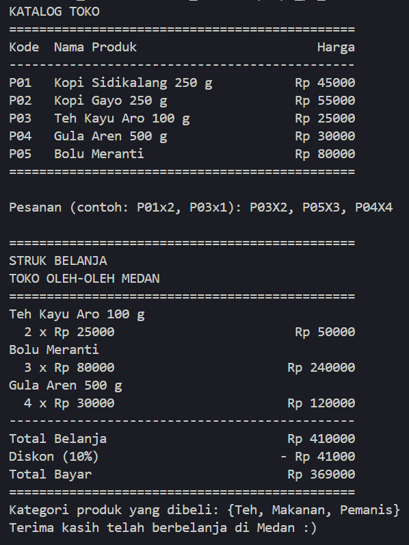
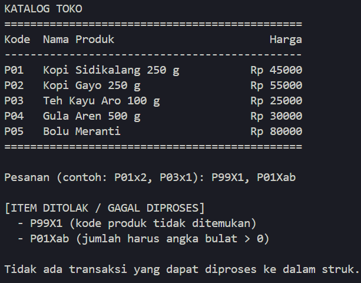
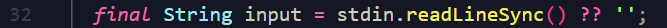
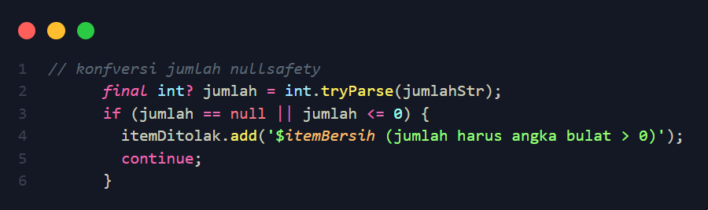
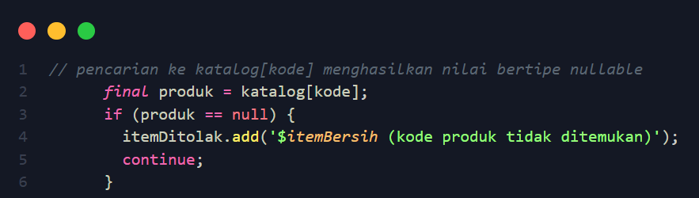

A. IDENTITAS
- Nama: Muhammad Rafli Wijaya
- NIM: 4243250017
- Kelas: PSIK 24D

B. TANGKAPAN LAYAR OUTPUT
- Skenario Pesanan Valid

- Skenario Pesanan Tidak Valid (Kode salah & jumlah tidak valid)

C. Perbedaan var, final dan const
- VAR: Nilainya bisa diubah berkali-kali, asalkan tipe datanya tetap sama sejak awal inisialisasi.	Biasanya digunakan saat nilai variabel memang direncanakan berubah-ubah (misalnya variabel penghitung/counter, akumulator loop). Dibuat bisa kapan saja saat runtime.

- FINAL: Nilainya tetap / terkunci setelah diisi pertama kali (immutable reference). Pilihan default yang paling dianjurkan di Dart modern untuk data yang tidak akan berubah setelah dibaca/dihitung (seperti input user, data katalog, list pesanan). Dibuat Sekali saat program berjalan (runtime).

- CONST: Konstanta mutlak/beku. Nilainya harus sudah diketahui secara pasti sebelum program dijalankan dan tak pernah berubah.	Nilai batas tetap, rumus, konfigurasi statis, atau teks yang nilainya tidak bergantung pada input runtime. Dibuat saat kode dikompilasi.

Bagaimana nullsafety bekerja?
Pertama: Input Keyboard Terminal

Saya menggunakan operator null-coalescing (??). Kalau hasil pembacaan adalah null, Dart otomatis menggantinya dengan string kosong ''. Dengan begitu, pemanggilan method di baris berikutnya seperti input.trim().isEmpty dijamin aman dan tidak akan pernah crash.

Kedua: Parsing Jumlah Barang (Mencegah Crash Akibat Input Huruf / Rusak)

Jika memakai int.parse('abc'), program akan langsung melempar FormatException dan berhenti paksa (crash) karena kata 'abc' tidak bisa dijadikan bilangan bulat.
Jadi saya memilih method int.tryParse() yang memiliki tipe kembalian nullable int?. Kalau input salah/berupa huruf, Dart tidak melempar error, melainkan mengembalikan nilai null. Kemudian dengan pengecekan if (jumlah == null), kita bisa menangkap kesalahan tersebut dengan aman, lalu catat ke itemDitolak, dan melanjutkan program tanpa crash.

Ketiga: Pencarian Kode Produk di Katalog (Mencegah Crash Akibat Kode Salah)

Akses ke Map pakai kunci (katalog[kode]) pada Dart selalu menghasilkan tipe nullable (Record?). Jika pembeli memasukkan kode yang tidak ada (misalnya 'P99'), hasil dari katalog['P99'] adalah null. Jika tanpa pengaman kita langsung memanggil katalog['P99'].harga, program akan melempar fatal error: NoSuchMethodError: The getter 'harga' was called on null.
Jadi kita memeriksa if (produk == null). Melalui mekanisme canggih Dart yang disebut Type Promotion, compiler tau bahwa setelah blok if (produk == null) dilewati, variabel produk pasti bukan null. Oleh karena itu, kita dapat langsung mengakses produk.nama, produk.harga, dan produk.kategori dengan aman tanpa perlu tanda seru (!) paksa.

